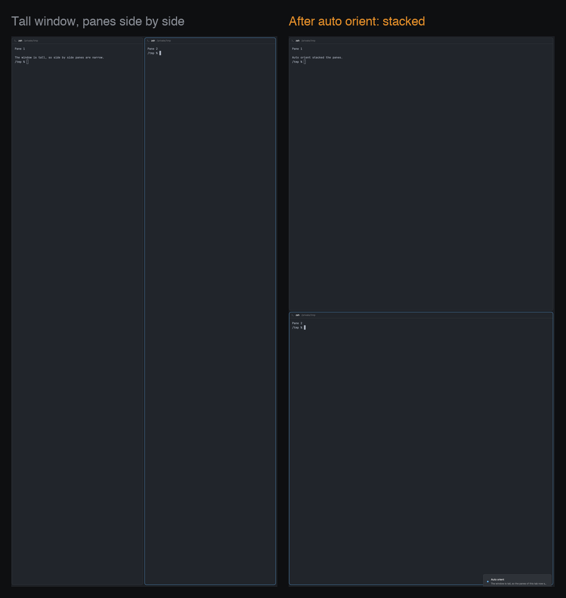

# Auto orient for Herdr

A mod for the [Herdr](https://herdr.dev) app. The panes of a tab follow the shape of the window. Move the window to a vertical monitor, and the panes stack top to bottom. Move it back to a wide monitor, and they sit side by side again. The programs in the panes keep running.



## Install

Ask your agent in Herdr:

```
Read ~/.config/herdr-app/AGENTS.md, then add this mod: herdr.dev/mods/jonleesy/herdr-auto-orient
```

Or by hand:

1. Copy `mods/auto-orient/` to `~/.config/herdr-app/mods/`.
2. Add a floating block to your own layout (clone a shipped one first with `layout.clone`): `{ "id": "auto-orient", "content": { "mod": "auto-orient" }, "edge": "left", "align": "start" }`.
3. Merge `keys.json` into `~/.config/herdr-app/keys.json`.
4. Run `herdr-app check ~/.config/herdr-app/mods/auto-orient`.

## Keys

| Key | What it does |
|---|---|
| `cmd-alt-o` | Turns auto orient on and off. |
| `cmd-alt-shift-o` | Fits the shown tab to the window now. |

## What it changes

- Only a tab whose panes are all in one row or one column. A grid stays as it is.
- Only after the window changes shape (tall or wide). It does nothing when it starts, and nothing to a tab that you arrange after the change.
- Each tab one time for each change, when you look at it.

It uses Herdr's own commands (`terminal.park` and `terminal.keep`). It runs `hc get` to read terminal sizes, and it reads Herdr's `window.json` for the window size. It uses no network. `RECIPE.md` has the full details.

## License

MIT. See `LICENSE`.
