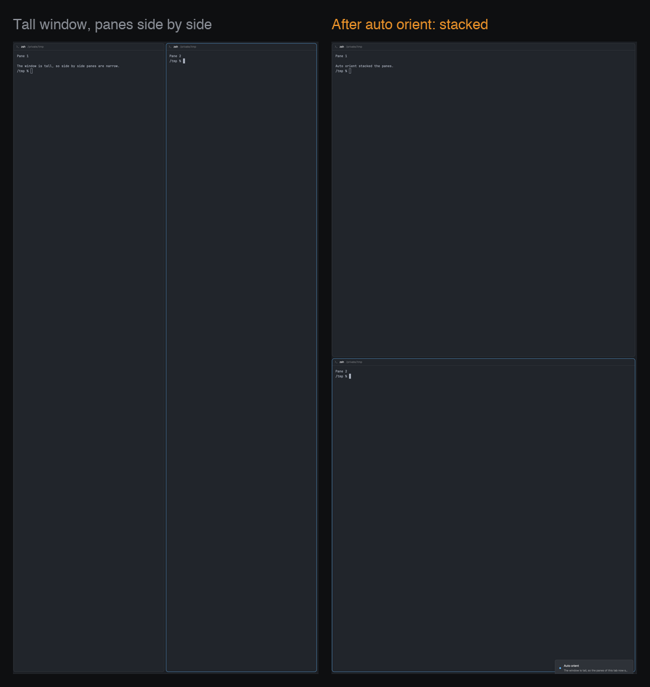

# Auto orient

The panes of a tab follow the shape of the Herdr window. Move the window to a vertical monitor, and the panes of each tab stack top to bottom. Move it back to a wide monitor, and the panes sit side by side again. The programs in the panes keep running. Nothing shows on screen, except a short toast when panes move.

## What you see

- Nothing in the layout. The mod sits in an empty floating block and draws nothing.
- A toast (Herdr's `toast` mod) each time the mod moves panes. The title is "Auto orient". The body is "The window is tall, so the panes of this tab now stack." or "The window is wide, so the panes of this tab are now side by side." Level `info`, 3 s. An error uses level `error`, 8 s.
- A toast when you turn the mod on or off: "Auto orient is on" or "Auto orient is off".

## How it behaves

- Window shape: tall when the height is at least 1.15 times the width, wide when the width is at least 1.15 times the height. Between the two (about square), the mod does nothing.
- The shape must stay the same for 1.5 s before panes move. Thus a window that you drag across monitors does not cause moves.
- When the shape changes (from tall to wide, or from wide to tall), the mod marks every tab that exists at that time. It fits each marked tab the next time that tab shows. The shown tab is fitted at once. Each tab is fitted one time for each change.
- Fit: a tall window wants a column (stacked panes), and a wide window wants a row (panes side by side). When all panes of a tab are in one row or one column, and it is the wrong one, the mod moves the panes. The first pane stays. The others follow it in their old order: left to right becomes top to bottom, and back.
- The mod does not change: a tab with one pane, a grid or any other mixed arrangement, a tab with a zoomed pane, a tab with a mod pane, a tab on another machine, a tab that you make or arrange after the change, and anything when the mod starts (it only learns the shape then).
- Agent status (working, blocked, done, idle) does not matter. A moved agent keeps running and keeps its status. The focus goes back to the terminal that had it.
- A new pane takes half of the pane it splits from. Thus three or more panes do not get equal sizes. Drag the dividers.
- Keys: `cmd-alt-o` turns the mod on and off, and a toast says which. When you turn it on, it learns the shape of the window again. `cmd-alt-shift-o` fits the shown tab now, also a tab that was fitted before or made after the change. If nothing moves, the toast says why.
- The on/off setting and the marked tabs stay after a restart (mod `localStorage`).

## Built from

- One mod, `mods/auto-orient/` (`main.js`, and `mod.json` `{ "place": "none", "title": "Auto orient" }`). It goes in a floating block of the person's own layout: `{ "id": "auto-orient", "content": { "mod": "auto-orient" }, "edge": "left", "align": "start" }`, for example in the `floating` list of the node that holds the terminals. The shipped layouts are read-only: clone one first (`layout.clone`).
- `render()` returns an empty `div()`, so the floating block does not show.
- Two `cx.spawn` loops. One ticks every 1000 ms (`cx.sleep`). One reads `nextCommand()` for `toggle` and `fit`.
- Window size: Herdr gives a mod no window size. The mod reads `bounds` (`[x, y, width, height]`) from `appHome()/window.json` with `readTextFile`. Herdr writes that file again within about 2 s of a move or a resize.
- Arrangement: `panes()` of the tab (in tree order), and `hc(["get", t, "--json"])` for the `cols` and `rows` of each terminal. Panes in a row have the same `rows`. Panes in a column have the same `cols`. An even split has both the same, so the mod also compares the mean of log(cols / rows / 2.4 / window aspect): below -0.45 is a row, above +0.12 is a column, and between is left alone (a grid is near 0).
- Move: `terminal.park` for each pane after the first. Then wait until the window's `panes()` does not list it and `hc get` shows no `herdr.tab` label. Then, for each one, `pane.focus {terminal: <the previous one>}` and `terminal.keep {terminal, place: "down" | "right"}`, until `panes()` lists it in the tab (1.5 s for each try, up to 4 tries). At the end, `pane.focus` on the terminal that had the focus.
- State: `localStorage` keys `on`, `shape` and `pending` (tab ids).
- Toasts: `notify`.
- Programs: `hc` (herdr-core), through the `hc()` function. It reads `window.json`, which is outside its own folder. It uses no network.

## Watch out

- `terminal.keep` fails with "no running terminal" when it runs before the window drops the parked terminal. This can happen after herdr-core has removed the `herdr.tab` label. Wait for both, and try again.
- Do not fit the shown tab when the mod starts. On the first start, and when Herdr starts with the same shape, the mod only learns the shape. A first build that fitted at start moved a person's side by side panes as soon as it loaded.
- A terminal that does not come back after 4 tries goes to a new tab of its own (`terminal.keep` with `place: "tab"`). Thus it never stays without a pane. It keeps running.
- The cell aspect (2.4) is an average. Fonts and line heights give 1.9 to 2.9. The limits keep two panes correct across that range. An unusual font can make an even split read as "not in one line", and then the tab stays as it is.
- The window shape includes the sidebar, so the work area is a little narrower than the window.
- `window.json` is Herdr's own file, and its format is not documented. If `bounds` changes form, the mod does nothing.
- The keys are macOS keys. On Linux and Windows, pick your own.

## Done when

- `herdr-app check ~/.config/herdr-app/mods/auto-orient` passes.
- In a wide window, a tab with two panes side by side stays as it is when the mod starts.
- Move the window to a tall monitor, or make it at least 1.15 times taller than wide. Within about 3 s, the side by side panes of the shown tab stack, and a toast says so. `hc get` shows the same `pid` for each terminal before and after.
- Show another tab that had panes side by side before the move: it stacks when it shows. Split a new tab side by side after the move: it stays as you made it.
- Move the window back to a wide monitor: the stacked tabs go side by side again.
- Press `cmd-alt-o`: the toast says "Auto orient is off". Then a move of the window changes nothing.
